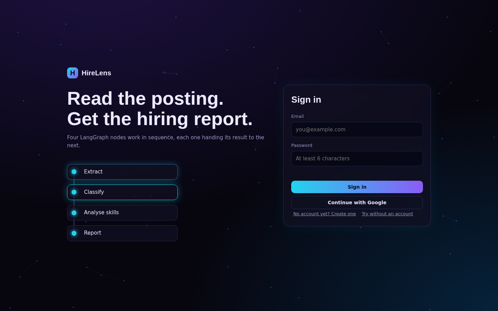
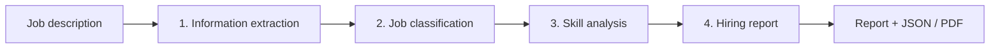
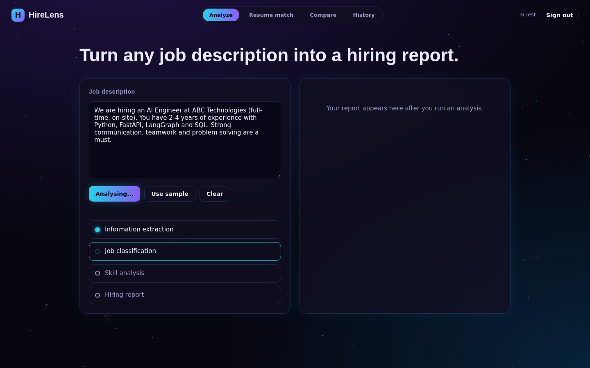
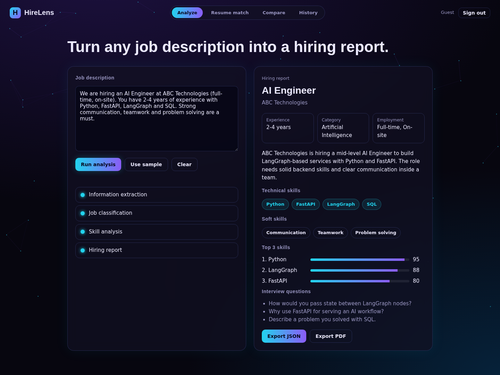
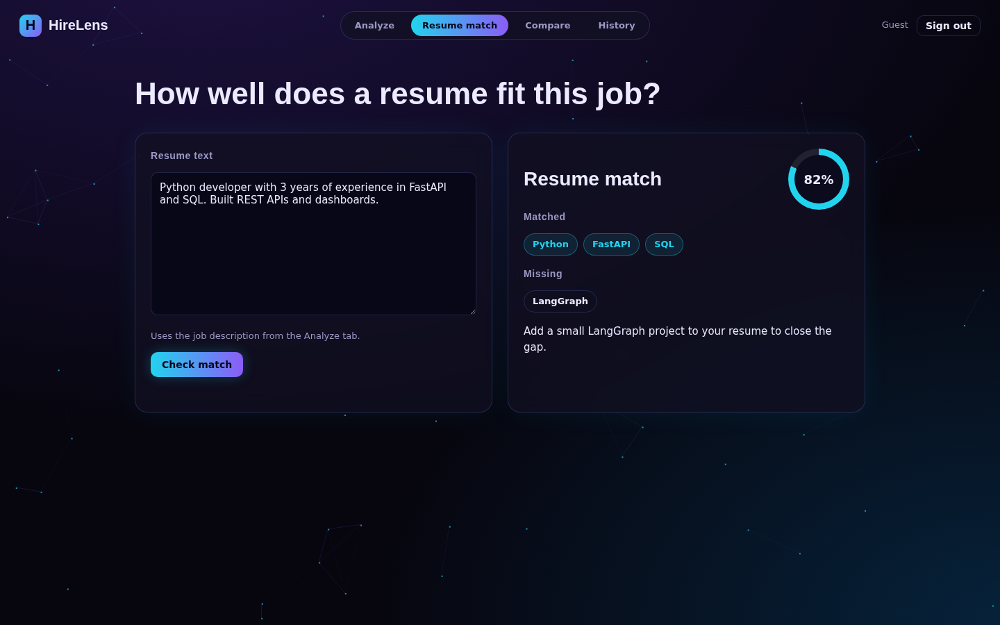
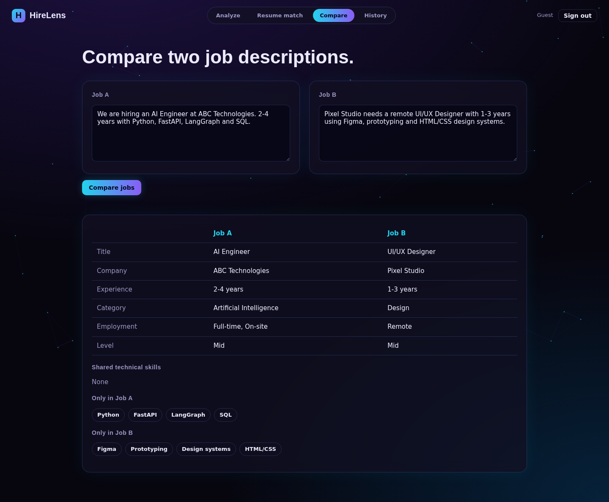
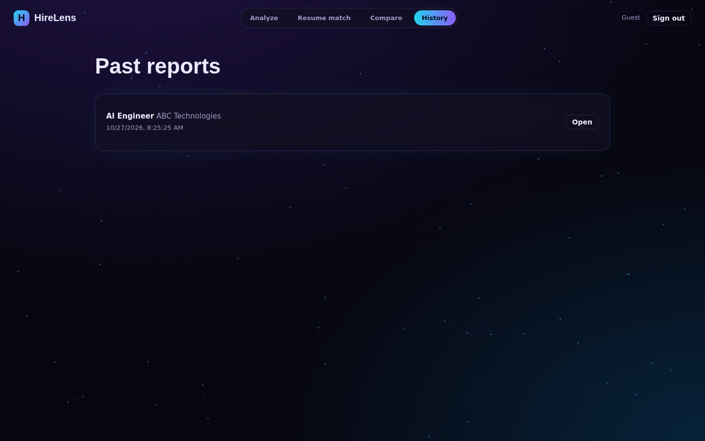
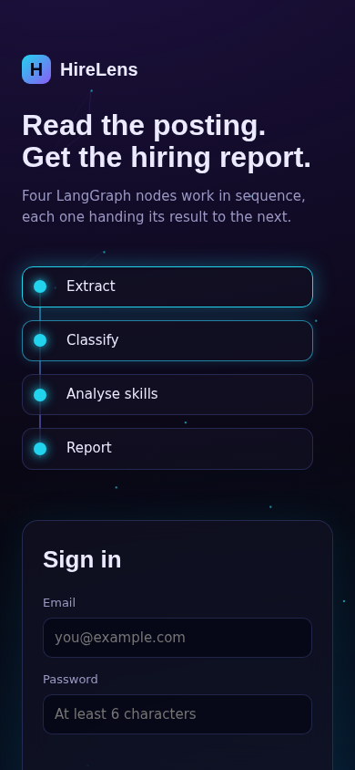

<div align="center">

# 🔍 HireLens

### AI Job Description Analyzer: turn any job posting into a structured hiring report




</div>

---

## ✨ What it does

Paste a job description and HireLens runs it through a **4-node LangGraph pipeline** powered by Groq. Each node adds its result to a shared state and hands it to the next one. The output is a clean hiring report.



| Node | Output |
|---|---|
| 1. Information extraction | Job title, company, required experience, required skills |
| 2. Job classification | Job category, employment type |
| 3. Skill analysis | Technical skills, soft skills, top 3 skills with scores |
| 4. Hiring report | Summary, difficulty level, interview questions |

## 🚀 Features

- 🔐 **Login** with Email or Google (Firebase Auth), plus guest mode
- 🧠 **4-node LangGraph workflow** with state passed between nodes
- 🏷️ **Skills as tags** and animated top 3 skill score bars
- 📄 **Resume match:** score, matched skills, missing skills, advice
- ⚖️ **Compare** two job descriptions side by side
- 🕘 **History** of the last 20 reports per user
- 📦 **Export** the report as JSON or PDF
- 🛡️ **Graceful errors** for empty, short or invalid input
- 🌌 **Dark futuristic UI** with an animated particle background, responsive and keyboard friendly

## 🖼️ Screenshots

| Analysis in progress | Hiring report |
|:---:|:---:|
|  |  |

| Resume match | Compare jobs |
|:---:|:---:|
|  |  |

| History | Mobile |
|:---:|:---:|
|  |  |

## 🧰 Tech stack

| Layer | Technology |
|---|---|
| Language | Python |
| AI workflow | LangGraph |
| LLM | Groq API (Llama 3.3 70B) |
| API | FastAPI |
| Validation | Pydantic |
| Frontend | HTML, CSS, JavaScript |
| Auth | Firebase Authentication |
| Hosting | Vercel |

## 📁 Project structure

```
hirelens/
├── api/
│   └── index.py            # FastAPI + LangGraph nodes + Groq
├── public/
│   ├── index.html          # login + app UI
│   ├── style.css           # dark futuristic theme
│   ├── app.js              # auth, analysis, compare, history, export
│   └── firebase-config.js  # your Firebase web config
├── docs/
│   ├── HireLens_Presentation.pptx / .pdf
│   ├── HireLens_Report.pdf / .html
│   └── screenshots/
├── vercel.json
├── requirements.txt
└── .env.example
```

## ⚙️ Run locally

```bash
git clone <your-repo-url>
cd hirelens
python -m venv venv
venv\Scripts\activate            # Windows  (macOS/Linux: source venv/bin/activate)
pip install -r requirements.txt

# Windows PowerShell:   $env:GROQ_API_KEY="your_key"
# macOS/Linux:          export GROQ_API_KEY="your_key"

uvicorn api.index:app --reload
```

Open <http://localhost:8000>.

## 🔥 Firebase setup

1. Create a project in the [Firebase console](https://console.firebase.google.com/).
2. **Authentication → Sign-in method:** enable **Email/Password** and **Google**.
3. **Project settings → Your apps → Web app:** copy the config into `public/firebase-config.js`.
4. After deploying, add your Vercel domain under **Authentication → Settings → Authorized domains**.

## ☁️ Deploy on Vercel

1. Push this repository to GitHub.
2. Import it in [Vercel](https://vercel.com/new).
3. Add the environment variable `GROQ_API_KEY`.
4. Deploy. `public/` is served as the website and `api/index.py` runs as the Python function.

## 🔌 API

| Method | Endpoint | Body | Returns |
|---|---|---|---|
| `GET` | `/api/health` | none | status and model name |
| `POST` | `/api/analyze` | `{ "job_description": "..." }` | full hiring report |
| `POST` | `/api/match` | `{ "job_description": "...", "resume_text": "..." }` | score, matched, missing, advice |

Example report:

```json
{
  "job_title": "AI Engineer",
  "company": "ABC Technologies",
  "experience": "2-4 years",
  "category": "AI",
  "employment_type": "Full-time, On-site",
  "technical": ["Python", "FastAPI", "LangGraph", "SQL"],
  "soft": ["Communication", "Teamwork", "Problem solving"],
  "top3": [
    { "skill": "Python", "score": 95 },
    { "skill": "LangGraph", "score": 88 },
    { "skill": "FastAPI", "score": 80 }
  ]
}
```

## 📚 Project documents

- 📊 Presentation: [`docs/HireLens_Presentation.pdf`](docs/HireLens_Presentation.pdf) (PowerPoint: [`.pptx`](docs/HireLens_Presentation.pptx))
- 📝 Report: [`docs/HireLens_Report.pdf`](docs/HireLens_Report.pdf)

## 👩‍💻 Author

**Anushay Ayat**: Artificial Intelligence and Data Science, SMIT

[](https://github.com/scientistayat-engineer)
[](https://www.linkedin.com/in/anushay-ayat-adnan-7732663a7)

<div align="center">

⭐ If you like this project, give it a star.

</div>
